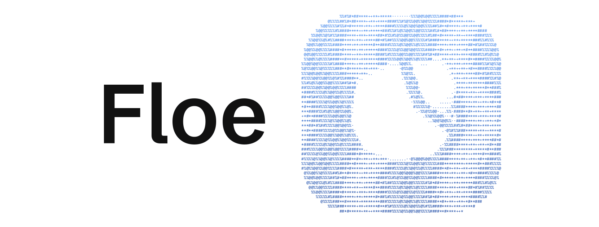

<p align="center">
  <a href="https://www.getthaw.app/floe">
    <picture>
      <source media="(prefers-color-scheme: dark)" srcset=".github/assets/header-dark.gif">
      
    </picture>
  </a>
</p>

<!-- Badges: shieldcn, as in Thaw's README (light/dark) -->
<p align="center">
  <a href="https://discord.gg/KDfWjWDnR4"><picture><source media="(prefers-color-scheme: dark)" srcset="https://www.shieldcn.dev/badge/Discord-join.svg?variant=outline&amp;size=xs&amp;mode=dark&amp;font=geist&amp;logo=discord&amp;" /></picture></a>
  <a href="https://sonarcloud.io/summary/overall?id=thaw-app_Floe"><picture><source media="(prefers-color-scheme: dark)" srcset="https://www.shieldcn.dev/sonar/quality-gate/thaw-app_Floe.svg?variant=outline&amp;size=xs&amp;mode=dark&amp;font=geist&amp;logo=sonarqubecloud" /></picture></a>
  <a href="https://sonarcloud.io/component_measures?id=thaw-app_Floe&amp;metric=reliability_rating"><picture><source media="(prefers-color-scheme: dark)" srcset="https://www.shieldcn.dev/sonar/reliability/thaw-app_Floe.svg?variant=outline&amp;size=xs&amp;mode=dark&amp;font=geist&amp;logo=sonarqubecloud" /></picture></a>
  <a href="https://sonarcloud.io/component_measures?id=thaw-app_Floe&amp;metric=security_rating"><picture><source media="(prefers-color-scheme: dark)" srcset="https://www.shieldcn.dev/sonar/security/thaw-app_Floe.svg?variant=outline&amp;size=xs&amp;mode=dark&amp;font=geist&amp;logo=sonarqubecloud" /></picture></a>
  <a href="https://sonarcloud.io/component_measures?id=thaw-app_Floe&amp;metric=sqale_rating"><picture><source media="(prefers-color-scheme: dark)" srcset="https://www.shieldcn.dev/sonar/maintainability/thaw-app_Floe.svg?variant=outline&amp;size=xs&amp;mode=dark&amp;font=geist&amp;logo=sonarqubecloud" /></picture></a>
  <a href="https://scorecard.dev/viewer/?uri=github.com/thaw-app/Floe"><picture><source media="(prefers-color-scheme: dark)" srcset="https://www.shieldcn.dev/github/scorecard/thaw-app/Floe.svg?variant=outline&amp;size=xs&amp;mode=dark&amp;font=geist" /></picture></a>
</p>

<p align="center">
  <a href="https://sonarcloud.io/summary/overall?id=thaw-app_Floe"><picture><source media="(prefers-color-scheme: dark)" srcset="https://sonarcloud.io/images/project_badges/sonarcloud-dark.svg" /></picture></a>
</p>

<p align="center">
  <b>The open source launcher for macOS.</b>
</p>

<p align="center">
  <a href="https://github.com/thaw-app/Floe/releases/latest">Download</a> ·
  <a href="#install">Install</a> ·
  <a href="#features">Features</a> ·
  <a href="#integrations">Integrations</a> ·
  <a href="https://github.com/thaw-app/.github/blob/main/.github/CONTRIBUTING.md">Contributing</a>
</p>

> [!NOTE]
> Floe is part of the Thaw project. Where this repository says nothing, [Thaw's rules](https://github.com/thaw-app/Thaw#project-documentation) apply here too.

<p align="center">
  
</p>

## Features

- **One hotkey, one search.** Applications, commands, quicklinks and System Settings panes, ranked by how often and how recently you use them. Aliases, hotkeys and favorites for the ones you use most.
- **Raycast extensions, unmodified.** Including the ones Raycast has already installed, on a Bun runtime inside the app, with an Extension Store page to install and update them.
- **The basics, built in.** Snippets, emoji, file search, calendar, a calculator with unit conversion, system commands, the menu bar's items and the front app's menus from the keyboard, and, once you switch it on, the shortcuts you made in Apple's Shortcuts app, run by name.
- **Your own apps, not replacements for them.** Pick the terminal, editor, browser, notes app and clipboard manager you already use, and Floe hands work to them, down to a host from your SSH configuration, which opens in your terminal.
- **Ask AI.** `ask` and a question shows the answer in the launcher, and you can follow it up there. You choose who answers: a command line tool you are already signed in to (`claude`, `codex`, `opencode` or `pi`), Apple Intelligence on your Mac, or an OpenAI-compatible API. A switch keeps all AI on your Mac.
- **Works with [Thaw](https://github.com/thaw-app/Thaw).** Thaw 3's actions are in the search, and the launcher can follow Thaw's menu bar appearance.
- **Private.** No analytics, no telemetry, no account. The Privacy page in Settings lists every permission and everything Floe contacts.

<details>
<summary><b>Full feature list</b>: everything the search answers to, by area</summary>

The [changelog](CHANGELOG.md) describes each in more detail.

### Search

- Open the search with one global hotkey (⌃⌥Space by default, changeable).
- Find applications, extension commands, script commands, quicklinks, System Settings panes and browser-installed web apps.
- Results are ranked by how often and how recently you use them, with fuzzy matching on scattered letters.
- Give an application or command an alias or a hotkey, and mark favorites that stay at the top.
- Set hotkeys for Emoji, Clipboard History, File Search and the system commands.
- Narrow a search to one place with a scope: `files`, `menu`, `menus`, `tabs`, `windows`, `bookmarks`, `recent`.
- Type a web address or a path in full to open it (`~/Downloads` gets the file actions).
- Type `keywords` or `?` to list every word the search answers to, with an example of each.
- Press the Up arrow to bring back the last 50 searches that opened something.
- Turn on files and open browser tabs (Safari, Dia, Helium) as extra search sources.
- Hide an application or command from the search, and bring it back in Settings.

### Results and actions

- Open an Actions menu (⌘K) on applications and files: hide, quit, restart, force quit, show in Finder, open with, copy, move to Trash.
- Open the Finder selection in your chosen terminal or editor.
- Use the search panel as a picker from a script: `Floe --pick` reads lines on standard input and prints the one you choose.

### Shell commands

- Type `>` and a command to run it in the background; the prefix can be `$` or `!`.
- ⌘Return opens it in your terminal, ⌥Return shows the full output, ⇧Return runs it in the front Finder folder.
- Your shell aliases work.
- Get suggestions from shell history, programs, paths, application names after `open -a` and hosts after `ssh`, with Tab to complete.
- Run a command without the prefix when it starts with a program and has a flag, path or pipe.
- Save a command under a name so the search finds it later.
- Type `man` and a program name to open its manual.
- Run Raycast-style script commands from a Scripts folder, with up to three arguments.

### Checkpoints and receipts

- `pause <name>: <note>` saves the Finder selection, the front browser window's tabs and a note.
- Search for the name to resume it; Floe lists anything that has moved or gone.
- `receipts` shows what Floe changed: commands run, files trashed, processes quit, extensions removed, notes, checkpoints, reminders and events.
- Press Return on a receipt to undo what can be undone, such as putting a file back from the Trash or deleting a reminder.

### Reminders, calendar, timers, people

- `remind <sentence>` adds to Apple Reminders, with natural-language dates and an optional list name.
- `event <sentence>` adds to Apple Calendar, timed or all-day.
- See calendar events in the search.
- `timer 10 minutes tea` starts a countdown with a notification and sound; `timers` lists and stops them.
- `contact <name>` finds people, with actions to call, FaceTime, message, email or copy.
- `mail` and `message` open a draft with an optional recipient.

### Media, Focus, system

- Play/Pause, Next, Previous and Now Playing for Spotify or Music.
- Toggle Focus, `focus 1 hour` and `focus off`, through a Shortcut you name.
- Sleep, lock, empty Trash, volume up and down, eject all disks.
- Toggle Wi-Fi, Bluetooth, mute and keeping the Mac awake.
- `kill <name>` lists matching processes with their memory, to quit or force quit.
- `port <number>` lists what is listening there.

### Built-in tools

- Calculator with unit conversion.
- Currency conversion with the European Central Bank's daily rates (opt-in).
- `define <word>` shows what the Mac's dictionary says about it. Return opens the word in the Dictionary app.
- `windows <title>` lists the open windows that match, to switch to one, minimize it or close it.
- Tab on an application, or `recent <app>`, lists the recently used files that open in it.
- `bookmarks <text>` finds a bookmark of Chrome, Brave, Edge, Arc, Vivaldi, Dia or Helium.
- `time in tokyo` and `time 5pm in berlin` show the time somewhere else.
- `uuid`, `password 24` and `lorem 3` make something to paste.
- `translate hola mundo` and `translate to german good morning` translate with Apple's translation, on this Mac. The row says it is Apple's, and that it can be rough.
- Pick Color from Screen shows the system's eyedropper and copies the color as hex.
- Copy Text from Screen reads the text, or the QR code, in the part of the screen you drag over. It needs Screen Recording.
- `qr https://example.com` makes a QR code to copy, look at or save.
- `maps coffee in lisbon` finds places with Apple Maps; Return shows one in Maps. What you type after `maps` is sent to Apple.
- `output` and `input` list the sound devices; Return makes one the device in use. AirPods show their battery.
- `battery`, `disk`, `memory` and `ip` show a fact about this Mac, under the other results. `battery` also lists a connected mouse, keyboard or headphones that report one.
- `brew ripgrep` finds a Homebrew package; Return installs or upgrades it in your terminal. `brew` alone lists what is installed.
- `base64`, `unbase64`, `urlencode`, `urldecode`, `uppercase`, `lowercase`, `titlecase` and `sha256` change the text after them, or the clipboard.
- Command-Y on a file shows it in Quick Look.
- Snippets with text expansion.
- Quicklinks with fallback searches.
- Emoji and symbols picker with a skin tone setting.
- File search through Spotlight, or Fast file search from Floe's own index of file names (opt-in).
- Menu bar item search that opens the items' menus from the keyboard.
- Search Menu Items lists the commands in the menus of the app in front, with their shortcuts, and runs the one you choose. `menus` does the same from the search.
- Run your Apple Shortcuts by name (opt-in).
- Connect to SSH hosts from `~/.ssh/config` in your terminal.

### Your own apps

- Choose a preferred terminal, editor, browser and notes app; files, folders and links open in them.
- Use a terminal editor (Helix, Neovim, Vim, Emacs and others) as the editor.
- Send a link to another browser with Open With.
- Keep a clipboard history: text with its formatting, links, images and files. Return pastes one, and copies marked private by a password manager are left out.
- Or choose a clipboard manager, and Clipboard History opens it. Floe then saves no copies.
- Browse Notes reads and writes the notes of a folder you chose, such as an Obsidian vault, in the panel. They are shown as Markdown, the files stay where your notes app keeps them, and the view says which app that is.
- Floating Note keeps one note in a window above other apps, on every Space. It reads and writes the notes of your folder, or of a Floe folder in Apple Notes. With Antinote or another app, it holds one scratch note until you send it there.

### Notes

- `note <text>` goes to Apple Notes, Antinote, any app with a URL scheme, or a folder of Markdown files.
- `append`, `todo` and `log` write to the day's note in a folder.
- In an Obsidian vault, the day's note follows the Daily notes folder and date format.

### Ask AI

- `ask <question>`, or the Ask AI row under any search, answers in the launcher.
- Ask follow-up questions that keep the conversation's context.
- Choose who answers: a signed-in command line tool (`claude`, `codex`, `opencode`, `pi`), Apple Intelligence, or an OpenAI-compatible API (OpenAI, OpenRouter, Z.ai, Ollama, LM Studio).
- Keep all AI on your Mac with one switch.
- Give one extension an AI source of its own.

### Extensions

- Run Raycast extensions unmodified, including ones Raycast already installed.
- Browse, install and update extensions in the Extension Store page.
- Use their lists, grids, details, forms, preferences, arguments, and background and interval commands.
- Let a command start another, with `launchCommand` or a `raycast://extensions/…` link.
- Add extension menu bar commands by hand.
- Switch off an extension or a single command, and set an alias, hotkey or custom icon per command.
- Remove an extension, whether Floe or Raycast installed it.
- See what each extension has reached: hosts contacted, folders touched, programs started.
- Sign GitHub and GitLab extensions in through `gh` and `glab`.
- Sign other extensions in through the browser, by way of Raycast's sign-in service for now, or enter a token where that cannot be received.
- See the log and run a command again when it throws, crashes or hangs.

<details>
<summary><b>Raycast extension compatibility</b>: a test against real extensions</summary>

[Raycast API compatibility](docs/COMPAT.md) goes through the API part by part.

On 2026-10-18, 1,850 of the 3,443 extensions in Raycast's extensions repository were installed with install scripts off and built with Floe's runtime. The view commands that could run without the app were run.

- **Built:** 6,035 of 6,052 macOS commands. The 17 that failed are in 6 extensions.
- **Ran:** up to two view commands per extension, for 10 seconds each, with no app to answer requests such as the clipboard or the browser. Of the 1,077 view commands that ran, 677 showed content, 192 showed a form, 62 showed an empty view, 9 showed nothing, 97 failed and 40 stopped at sign-in.
- **Not run:** 626 view commands that need preferences first and 38 that need arguments. 588 extensions whose code runs AppleScript or shell commands, moves files to the Trash or calls Swift or Rust. 90 extensions with no view command.
- **Not covered:** no-view and menu bar commands, commands that need preferences, arguments or sign-in, extensions that run AppleScript or shell commands, and how a command looks.

The build failures, by cause:

| Cause | Commands | Extensions |
| --- | --- | --- |
| A JSX entity escape Bun does not read | 1 | 1 |
| An import that only a package's CommonJS build has | 12 | 2 |
| An import of something not installed, in code that does not run | 2 | 2 |
| A Git dependency that its install script builds | 2 | 1 |

Built again on 2026-10-21, every command in the first three causes built. The 2 with the Git dependency still fail.

</details>

### Thaw

- Run Thaw 3's actions from the search: hidden sections, swap, Zen Mode, the Thaw Bar, the layout and application menus.
- Have the launcher follow Thaw's menu bar appearance.

### Appearance

- Pick a glass style, tint, border and shadow for the launcher, with a live preview.
- Choose the search field's shape, or float it as its own piece of glass.
- Use a compact layout that shows only the search bar until you type.
- Run a beam of light around the search field, in one of four colour sets, or switch it off.

### Settings, privacy and sync

- Search the settings from the top of the sidebar.
- See every permission and everything Floe contacts on the Privacy page, and turn sources, search history and receipts on or off there.
- Export and import settings as one file.
- Launch at login.
- Sync settings through iCloud, once a release is signed for it: aliases, hotkeys, favorites, hidden results, appearance, snippets, quicklinks and extension settings.
- Sync passwords through iCloud Keychain, by a separate switch.
- Remove Floe's settings from iCloud.

### Shortcuts and Siri

- Open Floe, run an extension command or search the menu bar from Apple's Shortcuts app.

</details>

## Transparency

- Free. No purchase, no subscription.
- Open source, AGPL-3.0. Read the code, build it yourself, fork it.
- No analytics, no telemetry, no account.
- One permission is required: Accessibility. Calendar, Reminders and Contacts are optional.
- Off until you turn them on: files, browser tabs, Shortcuts, Fast file search and currency rates.
- Settings > Privacy lists everything Floe contacts.
- Extensions are not sandboxed. Settings shows what each one has reached: hosts, folders and programs.
- Signed and notarized by Apple. Each release carries a build provenance attestation, and the project has an [OpenSSF Scorecard](https://scorecard.dev/viewer/?uri=github.com/thaw-app/Floe).

## Integrations

- [Thaw](https://github.com/thaw-app/Thaw): Thaw 3's actions are in the search, and the launcher can follow Thaw's menu bar appearance.
- [Raycast extensions](https://github.com/raycast/extensions): they run unmodified, including the ones Raycast already installed.
- Apple's Shortcuts app and Siri: Open Floe, Run Command and Search Menu Bar Items are actions there, and Floe runs the shortcuts you made by name.
- Your own apps: the terminal, editor, browser, notes app and clipboard manager you choose in Settings.
- Scripts: `Floe --pick` lends the search panel to a script.

```sh
ls ~/Projects | Floe --pick
```

A tab in a line splits it into a title and what is shown beside it, and the whole line is printed:

```sh
gh pr list --json number,title --jq '.[] | "\(.number)\t\(.title)"' | Floe --pick | cut -f1
```

## Install

Download Floe from the [releases page](https://github.com/thaw-app/Floe/releases/latest), open the disk image and move Floe to Applications.

- Needs macOS 26 or later.
- Signed and notarized, and it updates itself.
- Floe is early. Install only extensions you trust, since they are not sandboxed.

To build it from source, see [Development](docs/DEVELOPMENT.md).

## Roadmap

Next, in this order. The order can change.

1. **Documentation.** A guide for extension authors first: how to run a local extension in Floe, what works and what does not. Then Floe's section on the Thaw website.
2. **Floe's own sign-in service** for extensions, in place of Raycast's.
3. **More of the extension API:** deeplinks opened from outside Floe.
4. **Settings sync switched on:** releases signed for iCloud, then the same sync in Thaw.

Later:

- A small `@floe/api` package for what Raycast's API cannot express.
- Searching your notes.
- Calculator history.

Not planned:

- Window management, unless people ask for it. There are many window managers already, and Floe can work with them.

[What Floe does not do yet](docs/LIMITATIONS.md) lists the gaps as they stand today. To ask for something, [open an issue](https://github.com/thaw-app/Floe/issues). Every request is considered during the early releases.

## Contributors

Want to contribute? Read the shared [Thaw/Floe contribution policy](https://github.com/thaw-app/.github/blob/main/.github/CONTRIBUTING.md). Pull requests are welcome against `main`. Floe's text is translated on [Crowdin](https://crowdin.com/project/floe).

Open to partnerships, integrations, and sponsorships. [Get in touch](https://github.com/sponsors/diazdesandi).

<p align="center">
  <a href="https://github.com/thaw-app/Floe/graphs/contributors"><picture><source media="(prefers-color-scheme: dark)" srcset="https://shieldcn.dev/contributors/thaw-app/Floe.svg?title=false&amp;size=40&amp;names=true&amp;titleAlign=center&amp;limit=100&amp;mode=dark" /></picture></a>
</p>

## Project documentation

- [Contributing](https://github.com/thaw-app/.github/blob/main/.github/CONTRIBUTING.md)
- [Development](docs/DEVELOPMENT.md)
- [Changelog](CHANGELOG.md)
- [What Floe does not do yet](docs/LIMITATIONS.md)
- [Credits](CREDITS.md)
- [Governance](.github/GOVERNANCE.md)
- [Security policy](https://github.com/thaw-app/.github/blob/main/.github/SECURITY.md)
- [Code of conduct](https://github.com/thaw-app/.github/blob/main/.github/CODE_OF_CONDUCT.md)
- [Licenses of ported code](LICENSES/README.md)

## License

[AGPL-3.0](LICENSE). Code ported from other projects keeps its own terms; [LICENSES](LICENSES/README.md) says which license covers which folder.

[Credits](CREDITS.md) lists what Floe is built from, including [Thaw](https://github.com/thaw-app/Thaw), [Droppy Code](https://getdroppycode.app) by Jordy Spruit, [Barometer](https://github.com/mackid1993/Barometer) by mackid1993, [Audio Priority Bar](https://github.com/camguillory/Audio-Priority-Bar) by Camille Guillory and [CMD-Z](https://github.com/stonerl/CMD-Z) by Toni Förster. Raycast is a trademark of Raycast Technologies Inc. Floe is not affiliated with Raycast.
